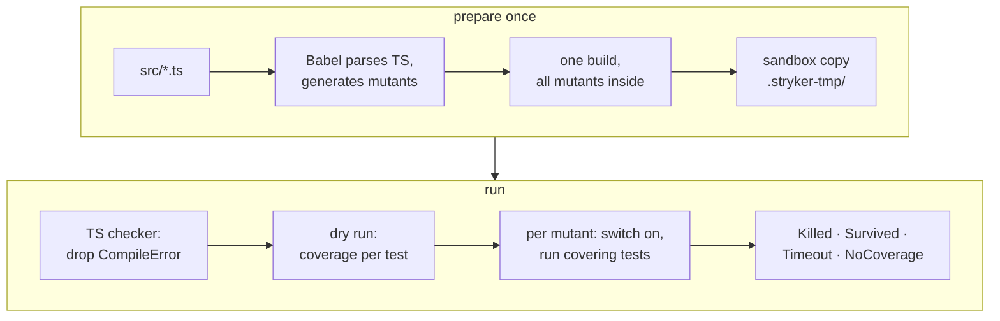
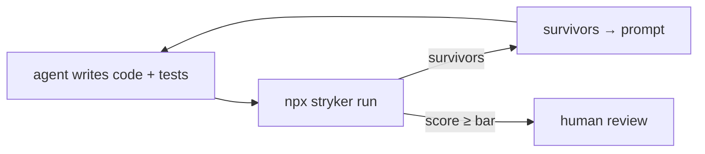

# The 100% Code Coverage Lie

## Finding hidden bugs with mutation testing

<div class="muted mt-10">Dimitar Mitev</div>

<!--
⏱ 0:30
§ Intro
Camera on. One sentence: "100% coverage tells you your code ran, not that it's tested. Today: how to find out what your tests really check." Tell them: questions in the Zoom chat any time, I'll take them at the end.
-->

---
layout: center
---

<div class="grid grid-cols-[auto_1fr] gap-12 items-center">


<div>

# Dimitar Mitev

<div class="text-xl mt-2">Solutions Architect</div>

<div class="muted mt-6 text-lg">writes tests. sometimes they even assert something.</div>

<div class="mt-8 text-base">

[linkedin.com/in/dimitar-mitev-3017437a](https://www.linkedin.com/in/dimitar-mitev-3017437a/) · [github.com/dnmitev](https://github.com/dnmitev)

</div>
</div>
</div>

<!--
⏱ 0:45
30 seconds max. Who I am, why I care: I've shipped bugs on 100% covered lines too.
-->

---
layout: center
---

<div class="big">What's your coverage gate in CI?</div>

<div class="muted mt-6 text-2xl">💬 type it in the Zoom chat: <code>none</code> · <code>70</code> · <code>80</code> · <code>90</code> · <code>100</code></div>

<!--
⏱ 1:00
Hook, Zoom version: ask them to type their coverage gate in the chat. Wait 15-20 seconds (chat lags), then read 3-4 answers out loud, by name. Anyone with 100? "Great, this talk is about you." Someone with "none"? "I envy your honesty."
-->

---
layout: center
---

<Meme src="this-is-fine.jpg" top="coverage: 100%" bottom="prod: on fire" width="40rem" />

<!--
⏱ 0:20
§ 1 · The green-report illusion
Agenda point 1: the green-report illusion.
Everyone has seen it: the badge is green, the dashboard is green, the sprint review screenshot is green. And on Friday evening something with a perfectly covered line breaks in prod.
-->

---
layout: center
---

<div class="big">Green CI ≠ working code</div>

<div class="muted mt-6">it means your code <strong>ran</strong>. that's it.</div>

<!--
⏱ 0:45
The whole talk in one sentence. Coverage answers "did this line execute during the tests?" It never answers "would any test fail if this line were wrong?"
-->

---
layout: center
---

# Coverage measures execution

```ts {all|3|all}
it('checks out', () => {
  // Look ma, no assertions!
  checkout(items);
});
```

<div class="muted mt-4">100% line coverage. 0% verification.</div>

<!--
⏱ 1:00
§ 2 · Coverage measures execution
Agenda point 2. This is a real test from the demo repo. It executes every line of checkout. Coverage tool is happy. It would pass if checkout returned the wrong total, a negative total, or a pizza emoji.
-->

---
layout: center
---

<Meme src="is-this-a-pigeon.jpg" width="28rem" :labels="[
  { text: 'coverage tool', x: 2, y: 64, w: 36, size: '1.6rem' },
  { text: 'checkout(items)', x: 56, y: 34, w: 44, size: '1.4rem' },
  { text: 'Is this a test?', x: 5, y: 84, w: 90, size: '2.2rem' },
]" />

<!--
⏱ 0:20
Calling code is not testing code. A test is an assertion about behaviour.
-->

---
layout: center
---

# The usual suspects

```ts
expect(subtotal(items)).toBeDefined();           // 0 is defined. so is NaN.
expect(applyCoupon(100, c)).toBeLessThan(100);   // 99.99? sure.
expect(() => checkout([])).toThrow();            // any error. even a typo.
expect(typeof isCouponValid(c, 100, now)).toBe('boolean'); // 🤡
```

<!--
⏱ 1:15
Four patterns everyone has written (me too). All of them push coverage up, none of them pin down behaviour. Point at the typeof boolean one, wait for laughs.
Then: "Ask a coding agent to get coverage to 100% and this is exactly what you get back. Fast." Plant the seed, we come back to agents after the demo.
-->

---
layout: center
---

<div class="big">"When a measure becomes a target, it ceases to be a good measure."</div>

<div class="muted mt-6">Goodhart's law</div>

<!--
⏱ 0:45
Set a coverage target and people will hit it, with the cheapest tests possible. Nobody is evil, the metric just rewards running code, not checking it.
-->

---
layout: center
---

<div class="big">Who tests the tests?</div>

<!--
⏱ 0:20
§ 3 · Mutation testing in a nutshell
Transition to agenda point 3. We review code, we lint code, we type-check code. Tests are code. Who checks that they actually catch anything?
-->

---
layout: center
---

# Mutation testing in one slide

<v-clicks>

1. Take your code, break it on purpose (a **mutant**)
2. Run your tests
3. Tests fail → mutant **killed** ✅
4. Tests pass → mutant **survived** 🧟

</v-clicks>

<div v-click class="mt-8 big">score = killed / all</div>

<!--
⏱ 1:15
The idea is from 1971, Richard Lipton. It was just too slow for 40 years. Now it isn't.
If you can change the code and no test notices, that code isn't really tested.
-->

---
layout: center
---

# What a mutant looks like

```diff
- return amount >= FREE_SHIPPING_THRESHOLD ? 0 : SHIPPING_FEE;
+ return amount > FREE_SHIPPING_THRESHOLD ? 0 : SHIPPING_FEE;
```

```diff
- return coupon.expiresAt > now && orderAmount >= coupon.minOrder;
+ return coupon.expiresAt > now || orderAmount >= coupon.minOrder;
```

```diff
- throw new Error('Cart is empty');
+ throw new Error("");
```

<div class="muted mt-4">the bugs you would write on a Friday afternoon</div>

<!--
⏱ 1:00
Mutators simulate real mistakes: off-by-one, wrong boolean operator, removed block, wrong string, flipped condition. Stryker has ~30 of them for JS/TS.
-->

---
layout: center
---

# Quiz: spot the survivor 🧟

```ts
const canBuyBeer = (age: number) => age >= 18;

it('checks age', () => {
  expect(canBuyBeer(30)).toBe(true);
  expect(canBuyBeer(5)).toBe(false);
});
```

<div class="grid grid-cols-4 gap-4 mt-6 text-xl font-mono">
  <div>A <code>age &gt; 18</code></div>
  <div>B <code>age &lt; 18</code></div>
  <div>C <code>true</code></div>
  <div>D <code>false</code></div>
</div>

<div class="muted mt-4">💬 which mutant survives? A, B, C or D in the chat</div>

<div v-click class="text-4xl font-extrabold mt-4">A. nobody tested 18.</div>

<!--
⏱ 1:30
Give them 20-30 seconds, Zoom chat is slow. Read a few answers. Then reveal: B fails for 30, C fails for 5, D fails for 30. A survives because no test uses exactly 18. 100% coverage, and an 18-year-old can't buy a beer.
This is the whole talk in one slide; the demo is the same bug with free shipping.
-->
---
layout: center
---

# Mutant statuses

| | |
|---|---|
| **Killed** | a test failed. good. |
| **Survived** | all tests passed. bad. |
| **No coverage** | no test even ran it. worse. |
| **Timeout** | infinite loop. counts as killed. |
| **Compile error** | TypeScript said no. not counted. |
| **Ignored** | you said no. with a reason, hopefully. |

<!--
⏱ 0:45
Keep this short. The ones that matter: survived and no coverage.
-->

---
layout: center
---


# StrykerJS

<div class="muted">JS · TS · Vitest · Jest · Mocha · Karma · Cucumber</div>

<!--
⏱ 0:30
§ 4 · StrykerJS: how it works + demo
Agenda point 4. StrykerJS, open source, v10 today. Works with every popular runner. We use Vitest 5 and TypeScript 7.
Demo: a small shopping cart pricing module. Subtotal, coupons, free shipping over 100.
-->

---
layout: center
---

# How Stryker runs (TypeScript)



<div v-click class="muted mt-6">no recompile per mutant · tsc only checks types · your tests run unchanged</div>

<!--
⏱ 1:30
1. Stryker parses your TypeScript with Babel (not tsc) and generates every mutant up front.
2. It writes ONE instrumented version of each file with all mutants inside (next slide) into a sandbox copy of the project. Your files are never touched.
3. The TypeScript checker type-checks mutants separately and throws out the ones that don't compile. That's the step where TS 7 native comes in.
4. Dry run: all tests once, recording which test reaches which mutant.
5. Then for each mutant: switch it on with a global flag, run only the tests that cover it. Test fails = killed, all pass = survived, hangs = timeout, no test reached it = no coverage.
No rebuild between mutants, the test runner workers stay warm. That's why it's feasible at all.
-->

---
layout: center
---

# All mutants, one build

```ts {1|5-9|all}
// @ts-nocheck   ← added by Stryker
export function shippingFor(amount: number): number {
  stryCov_9fa48("4");
  return (
    stryMutAct_9fa48("8") ? amount < FREE_SHIPPING_THRESHOLD :
    stryMutAct_9fa48("7") ? amount > FREE_SHIPPING_THRESHOLD :
    stryMutAct_9fa48("6") ? false :
    stryMutAct_9fa48("5") ? true :
    (stryCov_9fa48("5", "6", "7", "8"), amount >= FREE_SHIPPING_THRESHOLD)
  ) ? 0 : SHIPPING_FEE;
}
```

<div class="muted mt-4">real sandbox output, slightly trimmed · <code>stryMutAct</code> = is this mutant on? · <code>stryCov</code> = which test got here</div>

<!--
⏱ 1:15
Real output from the demo sandbox (cleanTempDir: false), trimmed a little. Mutants 5-8 are all variants of the >= comparison; at most one is active per run, chosen by a global (__stryker__.activeMutant).
@ts-nocheck: the instrumented code isn't type-safe, that's why type checking is a separate step on the original code.
stryCov records coverage per test. Code that runs at import time, when no test is running, lands in a "static" bucket: that's exactly why static mutants (our Zod schema) must run the whole suite.
Types stay in the file: Vitest strips them at runtime.
-->

---
layout: center
---

<Meme src="always-has-been.jpg" width="40rem" :labels="[
  { text: 'your code', x: 12, y: 44, w: 30, size: '1.6rem' },
  { text: 'Wait, all 50 mutants are in one build?', x: 40, y: 14, w: 26, size: '1.3rem' },
  { text: 'Always has been', x: 60, y: 72, w: 36, size: '1.6rem' },
]" />

<!--
⏱ 0:20
Pause a beat (on Zoom you won't hear the laugh). Then: this is why Stryker is fast enough to be usable. Older tools recompiled the project for every mutant.
-->

---
layout: center
---

# Demo 1: all green

<Clip src="demo-1-green.mp4" tag="step-1-green" />

<!--
⏱ 1:15
Video: tests pass, coverage 100% across statements, branches, functions, lines. Celebrate ironically.
-->

---
layout: center
---

# Demo 2: Stryker enters the chat

<Clip src="demo-2-reveal.mp4" tag="step-2-reveal" />

<!--
⏱ 2:45
Video: npx stryker run, 50 mutants, 21 survived. Open the HTML report, click through a few survivors.
-->

---
layout: center
---

<div class="huge">100% → 58%</div>

<div class="muted mt-6">same tests. same code. different question.</div>

<!--
⏱ 0:30
Coverage: 100%. Mutation score: 58.00%. 21 of 50 mutants survived. Let that sink in.
-->

---
layout: center
---

<Meme src="surprised-pikachu.jpg" width="22rem" :labels="[
  { text: 'Me: writes tests until coverage hits 100%\nStryker: 58%', x: 4, y: 8, w: 92, size: '1.25rem', dark: true },
]" />

<!--
⏱ 0:15
Let it sit for two seconds. On Zoom you won't hear the laugh, don't rush to fill the silence.
-->

---
layout: center
---

# Demo 3: kill them all

<Clip src="demo-3-kill.mp4" tag="step-3-kill" />

<!--
⏱ 3:15
Video: replace weak assertions with exact values, add boundary tests (99.99 / 100 / 100.01).
The boundary test at exactly 100 FAILS. Spec says "100 or more ships free", code says ">". That's the real bug.
-->

---
layout: center
---

# The surviving mutant was a bug report

```diff
  /** Spec: orders of 100 or more ship for free. */
- return amount > FREE_SHIPPING_THRESHOLD ? 0 : SHIPPING_FEE;
+ return amount >= FREE_SHIPPING_THRESHOLD ? 0 : SHIPPING_FEE;
```

<div class="muted mt-6">the bug lived on a 100% covered line</div>

<!--
⏱ 1:00
This is the punchline of the demo. Stryker didn't find the bug directly. It showed that no test cared about the boundary. The moment we wrote one, the bug fell out. Customers with exactly 100 in the cart paid 5.99 shipping.
-->

---
layout: center
---

<div class="huge">58% → 98%</div>

<div class="muted mt-6">one survivor left. and it's unkillable.</div>

<!--
⏱ 0:20
Cliffhanger: one survivor left and no test can kill it. Next section explains why.
-->

---
layout: center
---

# Making it practical

<div class="muted">reading results · equivalent mutants · run times</div>

<!--
⏱ 0:15
§ 5 · Making it practical
Agenda point 5. The usual objections: "too noisy", "too slow". Let's talk about both.
-->

---
layout: center
---

# Equivalent mutants

<div class="grid grid-cols-[3fr_2fr] gap-6 items-center">

```ts
if (coupon.value >= amount) {
  // mutant: coupon.value > amount
  return 0;
}
// amount - amount = 0 anyway
return roundMoney(amount - coupon.value);
```

<Meme src="they-are-the-same.jpg" width="17rem" :labels="[
  { text: 'value >= amount', x: 6, y: 15, w: 40, size: '0.85rem', dark: true },
  { text: 'value > amount', x: 52, y: 20, w: 40, size: '0.85rem', dark: true },
]" />

</div>

<!--
⏱ 1:00
An equivalent mutant changes the code but not the behaviour. No test can ever kill it. When value === amount both paths return 0.
-->

---
layout: center
---

# What to do with them

<v-clicks>

- **Refactor**: often it's redundant code telling you something
- **Ignore with a reason**:

```ts
// Stryker disable next-line EqualityOperator: '>' and '>=' both return 0 when value === amount
```

- ⚠️ that also ignores `<`, which *was* killable. disable as narrow as you can.
- **Accept** 98%. 100% mutation score is the new 100% coverage. don't chase it.

</v-clicks>

<!--
⏱ 1:00
Three options. Refactor first: an equivalent mutant often points at redundant code. If you ignore it, the disable comment needs a reason, and it switches off every mutant of that kind on the line (here also the killable "<"). And accept less than 100%: chasing 100% mutation score is the same trap as chasing 100% coverage.
-->

---
layout: center
---

<Meme src="one-does-not-simply.jpg" top="one does not simply" bottom="run all mutants on every PR" width="38rem" />

<!--
⏱ 0:20
Cost: every mutant can mean a test run. 5,000 mutants × a 2 minute suite is your weekend.
-->

---
layout: center
---

# Keeping run times sane

```json
{
  "testRunner": "vitest",          // perTest coverage: only tests that hit the mutant
  "mutate": ["src/**/*.ts"],       // scope it
  "incremental": true,             // only re-test what changed
  "ignoreStatic": true,            // skip mutants in static init code
  "concurrency": 4,
  "checkers": ["typescript"],      // drop mutants that don't compile
  "typescriptChecker": { "experimentalNativePreview": true }  // TS 7 ⚡
}
```

<!--
⏱ 1:15
Biggest wins in order: perTest coverage analysis (default with vitest runner), incremental mode, scoping mutate, then the checker.
-->

---
layout: center
---

# Demo 4: go fast

<Clip src="demo-4-fast.mp4" tag="step-4-fast" />

<!--
⏱ 2:15
Video: incremental run reuses 48 of 50 results in ~1 s. TS checker marks 13 mutants as compile errors, they never hit the test runner.
-->

---
layout: center
---

# TypeScript 7 🦫⚡

<v-clicks>

- native compiler (Go), ~10× faster type checks
- Stryker 10: `experimentalNativePreview` → TS 7 checks your mutants
- but TS 7 has **no classic JS API** and Stryker still needs it 🙃

</v-clicks>

<div v-click class="mt-6">

```json
"typescript": "6.0.3",                              // API shim for tooling
"@typescript/native": "npm:typescript@7.0.2"        // the real compiler
```

</div>

<!--
⏱ 1:15
Real gotcha we hit while building the demo: Stryker core reads tsconfig via the TS JS API. With only TS 7 installed you get "ts.parseConfigFileTextToJson is not a function". Fix: TS 6 as "typescript" for tools, TS 7 under the @typescript/native alias.
-->

---
layout: center
---

# Checker benchmark

| Mutants | no checker | TS 6 checker | TS 7 native |
|---|---|---|---|
| 50 | 3.0 s | 15.0 s | **3.0 s** |
| 500 | 11.6 s | 18.1 s | **11.2 s** |
| 2,000 | 40.4 s | **40.9 s** | 55.5 s 🐢 |

<div class="muted mt-4">synthetic: demo × N, M-series Mac, concurrency 4 · <code>demo/bench</code></div>

<div v-click class="big mt-6">it depends™</div>

<!--
⏱ 1:00
Synthetic workload: the demo cloned N times. Fast unit tests, so the checker can't save much test time here; with slow tests it saves more. TS 6 checker has startup cost, TS 7 native is close to free. Native checks mutants one by one, no grouping yet, watch it at large mutant counts.
-->

---
layout: center
---

# The fine print 🧾

<div class="muted">mutation testing is not free</div>

<!--
⏱ 0:15
§ 5 · The fine print
I promised honesty. Here is what it costs.
-->

---
layout: center
---

# It's slow. By design.

<div class="big mt-4">mutants × tests</div>

<v-clicks>

- demo: 50 mutants × 18 tests (5 ms) → **2 s**
- real service: 5,000 mutants × a 3-minute suite → **your weekend**
- perTest coverage + incremental make it bearable, not free

</v-clicks>

<!--
⏱ 0:45
Every mutant is potentially a full test run. Stryker is smart (only tests covering the mutant, incremental reuse), but the cost grows with code size times test time.
-->

---
layout: center
---

# Even slower in CI

| | laptop (M1 Max, 10 cores) | GitHub `ubuntu-latest` (4 vCPU) |
|---|---|---|
| 50 mutants | 2 s | 6 s |
| 500 mutants (bench) | 11.6 s | 21.1 s |
| 500 mutants + TS 6 checker | 18.1 s | 30.5 s |

<div class="muted mt-4">same commit, same config · <code>.github/workflows/bench.yml</code></div>

<!--
⏱ 0:45
Hosted runners have few cores, so concurrency drops and wall time grows. Plus npm ci and sandbox copy on every run. Options: incremental on PRs, full run nightly, larger runners if you can pay, or scope mutate to what changed.
-->

---
layout: center
---

# Cache the incremental report

<v-clicks>

- `reports/stryker-incremental.json`: every mutant's result + which tests covered it (~8 KB)
- PR run: re-test only mutants in **changed code** or covered by **changed tests**
- key `stryker-incremental-<branch>-<sha>` → fall back to own branch → **main**
- PRs read main's cache, not each other's · 7 days unused = evicted
- config / dependency changes aren't detected → nightly `--force`

</v-clicks>

<!--
⏱ 1:00
Stryker's incremental mode needs the previous result. On a laptop it's just a file; on GitHub runners every job starts empty, so it goes into actions/cache.
Restore order: this branch's last run, then main's. That's why main must run on every merge (and nightly, to stay inside the 7-day eviction window).
Incremental only diffs your source and tests. Bump vitest or change stryker.config.json and it won't notice: the nightly run uses --force.
-->

---
layout: center
---

# The gotcha: red PRs never save

```yaml {all|1-2|4-8}
- uses: actions/cache@v6           # saves only when the job succeeds 🙃
  # ... red PR → nothing saved → next push starts from main again

- uses: actions/cache/restore@v6   # restore and save as separate steps
# ... npx stryker run, report, gates ...
- uses: actions/cache/save@v6
  if: always()                     # save even when the job fails
```

| red PR, next push | reused |
|---|---|
| `actions/cache` | 43 / 59 (every time) |
| `restore` + `save` with `if: always()` | **57 / 59** |

<!--
⏱ 1:00
Measured on demo PR #2. With plain actions/cache the save step is skipped when the job fails, so every push to a failing PR re-tests all of its changes from main's baseline. The failing PR is exactly the one you iterate on.
On a re-run with the same commit you'll see "Failed to save: Unable to reserve cache": harmless warning, the key already exists.
-->
---
layout: center
---

# Static mutants

```ts
// runs once, when the module loads
export const CouponInput = z.object({
  code: z.string().trim().toUpperCase().regex(/^[A-Z0-9]{3,20}$/),
  type: z.enum(['percent', 'fixed']),
  value: z.number().positive().max(1000),
});
```

<v-clicks>

- no single test "covers" it → Stryker runs **all** tests for each one
- `ignoreStatic: true` → skipped... and never checked
- your whole Zod schema is static 😬

</v-clicks>

<!--
⏱ 1:00
Static code runs at import time, so per-test coverage can't tell which test depends on it. Stryker has to rerun the whole suite per static mutant. ignoreStatic trades that time for a blind spot.
And here's the catch: a Zod schema is exactly that kind of code. All your validation rules live at module level.
-->

---
layout: center
---

<div class="huge">18 / 28</div>

<div class="muted mt-6">Zod schema mutants silently ignored with <code>ignoreStatic: true</code></div>

<!--
⏱ 0:30
Measured on the demo coupon schema: 28 mutants, 18 ignored as static, 8 tested, 2 compile errors. Only the .refine() callback runs at parse time, so only its mutants were tested. Every other rule: regex, enum, limits, messages, ignored. Stryker still showed a nice green overall score.
-->

---
layout: center
---

# What Stryker does to a Zod schema

```diff
- z.string().trim().toUpperCase()
+ z.string().trim().toLowerCase()
- z.number().positive().max(1000)
+ z.number().positive().min(1000)
- .regex(/^[A-Z0-9]{3,20}$/)
+ .regex(/[A-Z0-9]{3,20}$/)
- z.enum(['percent', 'fixed'])
+ z.enum([])
```

<div v-click class="muted mt-4">not mutated: <code>1000</code>, <code>{3,20}</code>, <code>.positive()</code>, <code>.default(0)</code>, <code>.coerce</code> → test those anyway</div>

<!--
⏱ 1:00
Stryker's mutators are syntactic: method names it knows (min/max, toUpperCase/toLowerCase, trim), regexes, arrays, strings, objects. It doesn't know Zod, so numbers, .positive(), .default() and .coerce never get mutated. No surviving mutant there doesn't mean those rules are tested.
-->

---
layout: center
---

# ignoreStatic: the trade-off

| | ignoreStatic: true | ignoreStatic: false |
|---|---|---|
| schema mutants tested | 8 / 28 | **23 / 28** |
| ignored as static | 18 | 0 |
| run time (78 mutants) | 4.3 s | 4.6 s |

<div v-click class="mt-6 text-xl">validation = business rules → schemas get <strong>their own run</strong></div>

<div v-click class="mt-4">

```js
// stryker.schemas.config.mjs
export default { ...base, mutate: ['src/**/*-schema.ts'], ignoreStatic: false };
```

</div>

<!--
⏱ 1:00
The remaining mutants are compile errors (the TypeScript checker throws them out). Here the cost is 0.3 s. With a 3-minute suite, each static mutant costs 3 minutes, so measure before you flip it in a big repo. What the demo does: the main config keeps ignoreStatic true and excludes "!src/**/*-schema.ts"; stryker.schemas.config.mjs mutates only the schemas with ignoreStatic false and a 90% break. CI runs both and merges them into one PR comment. Fast default, strict where the rules live.
-->

---
layout: center
---

# More fine print

<v-clicks>

- **equivalent mutants**: a human has to decide, every time
- **flaky tests**: random kills and timeouts, noisy scores
- **missing code**: no mutant for the check you never wrote
- **gameable**: snapshots kill mutants without verifying intent
- **setup**: monorepos, sandboxes, TS 7 checker still experimental

</v-clicks>

<!--
⏱ 1:00
The "missing code" one is important: mutation testing judges the tests against the code that exists. If the requirement isn't implemented at all, there is nothing to mutate. It complements thinking, it doesn't replace it.
-->

---
layout: center
---

# Adopting it in your team

<div class="muted">where to start · CI · thresholds</div>

<!--
⏱ 0:15
§ 6 · Adopting it in your team
Agenda point 6.
-->

---
layout: center
---

# What's worth mutating?

<div class="grid grid-cols-2 gap-10 text-left text-lg">
<div>

### ✅ worth it

- 💰 money: pricing, tax, rounding
- 🔐 auth & permissions
- 🛂 validation at trust boundaries (Zod)
- 🔁 state machines, dates & expiry
- 📚 shared libraries
- 🤖 code written by agents

</div>
<div>

### ⏭️ skip it

- 🎨 UI markup & styling
- 🧵 glue code, DI wiring
- 📝 logging, metrics, messages
- 🏭 generated code, migrations
- 🔌 thin wrappers around 3rd-party APIs
- 🐌 anything with slow or flaky tests

</div>
</div>

<div v-click class="mt-8 text-xl">mutate where a flipped <code>&gt;</code> costs money or a flipped <code>&amp;&amp;</code> lets someone in</div>

<!--
⏱ 1:30
Rule of thumb: code where a small mistake is expensive, and where the logic branches.
Left: an off-by-one in pricing is our free-shipping bug; && → || in an isAllowed check is a security hole that passes the happy-path tests; Zod schemas we just saw; status transitions and expiry dates are boundaries everywhere; a shared lib spreads one survivor to every team; agent code because the tests were written to pass.
Right: UI markup mutants change strings and class names and the tests that kill them are brittle snapshots; glue code has no logic, integration tests cover it; nobody should write tests for log messages; generated code isn't yours; wrappers test your mocks; slow/flaky suites cost more than they tell you, fix them first.
Zod is on the left only at trust boundaries: a schema that just describes a type is mostly noise.
-->
---
layout: center
---

# Where to start

<v-clicks>

1. one module that **matters** (pricing, auth, permissions)
2. run locally, read the report, fix 3 survivors
3. add to CI as **report only** (`break: null`)
4. raise the bar slowly
5. never as a vanity badge. *we've been here before*

</v-clicks>

<!--
⏱ 1:00
Concrete starting plan: one module that matters, run it locally, read the report, fix three survivors. Then CI in report-only mode (break: null), raise the bar slowly. Never as a vanity badge on the README... says the guy with a badge on his README.
-->

---
layout: center
---

# Thresholds

```json
"thresholds": { "high": 80, "low": 60, "break": 50 }
```

| | |
|---|---|
| ≥ high | 🟢 |
| ≥ low | 🟡 |
| < break | ❌ CI fails |
| **lines changed in the PR** < 80% | ❌ CI fails |

<!--
⏱ 1:00
Start with break low or null. The goal is the conversation in code review, not another number to game.
The last row is the one I like most: legacy code can sit at 60%, but new code is held to 80%. The overall average can't hide a badly tested new feature. (Not a Stryker option: ci-samples/report.mjs computes it from the PR diff.)
-->

---
layout: center
---

# Demo 5: in CI

<Clip src="demo-5-ci.mp4" tag="main (PRs #1–#2)" />

<!--
⏱ 2:45
Video: PR #1 (weak tests) red with 45.71%, PR #2 (new feature) green overall 93% but red on changed lines 70%. Sticky comment, inline annotations on the diff, HTML report artifact.
-->

---
layout: center
---

# Reporting people actually read

<v-clicks>

- 💬 **sticky PR comment**: score, Δ vs main, score on *your* lines, survivors as diffs
- 📍 **inline annotations** on the exact line in "Files changed"
- 🚦 **gates** run *after* the report is posted
- 🌐 **live report + badge** from main on GitHub Pages

</v-clicks>

<!--
⏱ 1:00
Nobody downloads an HTML artifact from a CI run. People read PR comments and look at the diff. Put the survivors where the reviewer already is.
All of this is ~200 lines in ci-samples/report.mjs, no paid service. Stryker Dashboard is the hosted alternative (free for open source).
-->

---
layout: center
---

# Demo 6: Zod in a PR

<Clip src="demo-6-zod.mp4" tag="main (PRs #5–#6)" />

<!--
⏱ 2:15
Video: PR #5, agent tests, "18 mutants ignored (static)", 50% on changed lines. PR #6: tests for every rule + a separate schemas config (ignoreStatic false, break 90), all 23 testable schema mutants killed, main run stays fast.
-->

---
layout: center
---

<Meme src="drake.jpg" width="24rem" :labels="[
  { text: 'coverage: 100%', x: 52, y: 20, w: 46, size: '1.5rem', dark: true },
  { text: 'mutation score: 80%', x: 52, y: 70, w: 46, size: '1.5rem', dark: true },
]" />

<!--
⏱ 0:15
The whole CI section in one picture. Two seconds, move on.
-->

---
layout: center
---

# Agents write the tests now

<div class="muted">and who tests the agent's tests?</div>

<!--
⏱ 0:30
§ AI agents write the tests now
Section on AI. My workflow: agents write a lot of code and tests, and I use Stryker to check whether those tests are good enough to give me confidence. (Add your own example: which agent, what kind of project.)
-->

---
layout: center
---

<div class="big">Agents are <strong>really</strong> good at making tests pass.</div>

<div v-click class="muted mt-8 text-2xl">that's not the same as testing.</div>

<!--
⏱ 0:45
An agent optimises for the goal you give it. "Tests green, coverage 100%" is a goal it can reach without checking anything: weak assertions, snapshots of whatever the code returns today, mocking the very thing under test.
Goodhart's law, now at 100 tokens per second.
-->

---
layout: center
---

# Typical agent-written test

```ts
it('calculates the receipt correctly', () => {
  const receipt = checkout(items, coupon, now);
  expect(receipt).toMatchSnapshot();   // whatever it returns today is "correct"
  expect(receipt.total).toBeDefined();
});
```

<div class="muted mt-4">great name. 100% coverage. tests nothing on day one.</div>

<!--
⏱ 0:45
The test name is perfect, the reviewer skims it, LGTM. The snapshot freezes current behaviour, including the off-by-one bug we just found.
-->

---
layout: center
---

# Stryker as the agent's reviewer



<!--
⏱ 1:00
The loop I use: agent writes the change and the tests, Stryker runs, surviving mutants go back to the agent as a concrete to-do list. A human still reviews, but now the review starts from "the tests can catch these changes", not from hope.
-->

---
layout: center
---

# Survivors as a prompt

```md
Write or improve tests so that each change makes at least one test fail.
- Do not change anything under src/. If a test reveals a bug, stop and report it.
- Do not add "Stryker disable" comments.

- `src/cart.ts:26` EqualityOperator (Survived)
  - original: `return amount >= FREE_SHIPPING_THRESHOLD ? 0 : SHIPPING_FEE;`
  - mutated:  `return amount > FREE_SHIPPING_THRESHOLD ? 0 : SHIPPING_FEE;`
```

<div class="muted mt-4"><code>ci-samples/survivors-to-prompt.mjs</code> · uploaded as a CI artifact on every PR</div>

<!--
⏱ 0:45
Far better than "write better tests". Concrete, checkable, small. The "don't touch src" rule matters: otherwise the agent "fixes" the mutant by changing the code until the test passes.
-->

---
layout: center
---

# Demo 7: agents in the loop

<Clip src="demo-7-agents.mp4" tag="main (PRs #2–#4)" />

<!--
⏱ 2:45
Video: PR #2 agent-written tests, gate fails, download agent-prompt.md. PR #3: the agent "fixed" it with Stryker disable comments: score 100%, headline warns 8 ignored mutants, gate fails. PR #4: proper tests, 100% on changed lines, green.
-->


---
layout: center
---

# Agents game metrics too

<v-clicks>

- `// Stryker disable all` → **CI fails** without a reason, every new disable listed for review
- snapshot everything → kills mutants, verifies nothing
- edits `src/` to make tests pass → keep test tasks test-only
- score is a **signal** for review, not a target

</v-clicks>

<!--
⏱ 1:00
Common ways agents game it: adding Stryker disable comments, changing the implementation so their test passes, snapshot-testing a whole object. (Add your own war story here if you have one.) The PR workflow in the repo fails on disable comments without a reason and lists all new ones in the job summary.
-->

---
layout: center
---

<div class="big">Mutation score = trust signal for code you didn't write.</div>

<!--
⏱ 0:20
One-line summary of the AI section. With agents writing more of the code, "the tests pass" is worth less every month. "The tests catch changes" is what I check.
-->

---
layout: center
---

# Takeaways

<v-clicks>

1. Coverage = code **ran**. Mutation score = code is **checked**.
2. A surviving mutant is a bug report waiting to happen.
3. Agents write tests fast. Stryker tells you if you can trust them.
4. It's slow and has blind spots. Start small, incremental in CI, never a vanity metric.

</v-clicks>

<!--
⏱ 1:30
§ 7 · Takeaways & Q&A
Agenda point 7.
-->

---
layout: center
---

<div class="big">Try it on Monday</div>

```bash
npm init stryker@latest
```

<!--
⏱ 0:30
One command, answers a few questions (test runner, checker), writes the config. Then npx stryker run.
-->

---
layout: center
---

<div class="grid grid-cols-[auto_1fr] gap-12 items-center">


<div>

# Grab the repo

<div class="text-2xl mt-4">

**github.com/dnmitev/coverage-lie**

</div>

<div class="muted mt-6 text-lg">demo with every step tagged · CI workflows · these slides</div>

</div>
</div>

<!--
⏱ 0:30
Leave this up for a few seconds, people need time to scan.
-->

---
layout: end
---

# Questions?

<div class="flex gap-10 items-center justify-center mt-8">


<div class="text-left text-lg leading-loose">

[github.com/dnmitev/coverage-lie](https://github.com/dnmitev/coverage-lie)<br />
[linkedin.com/in/dimitar-mitev-3017437a](https://www.linkedin.com/in/dimitar-mitev-3017437a/)

</div>
</div>

<!--
⏱ 0:15
Read questions from the chat. Repeat each question out loud before answering: it's recorded, and not everyone sees the chat. If the chat is quiet, seed it: "The question I always get: how long does this take on a real project?"
-->
